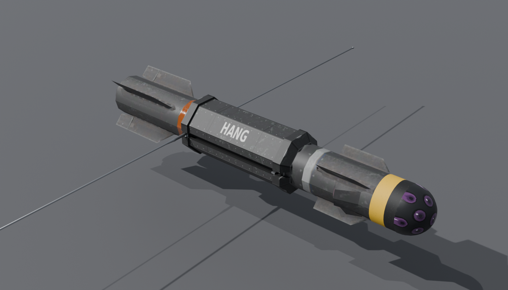
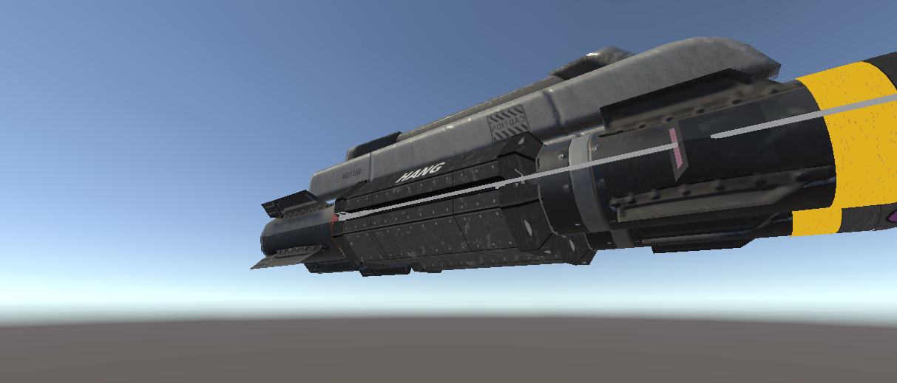

# Hangball Mk.II

**Hang-Aloft Node Guided (HANG)** variant of the Eyeball Mk.II for Nuclear Option.

When a target is selected, it flies over the target and deploys a parachute, hanging to scan and spot for Datalink as it descends. Without a target, the Hangball deploys the chute when it runs out of energy instead of self-destructing.



## Features

- Octagonal chute-pack casing around the midsection, with the chute lines attached at the rear of the pack.
- Two HF wire antennas stowed in recessed channels along the body. They fold out to 90° when the chute opens.
- Hangs nose-down under the chute and settles vertically, then self-destructs on touchdown.
- Glass sensor nose with distributed apertures.
- Carried on the Eyeball's double pylon ("Hangball Mk.II x2").
- Cost: 0.126.


## Requirements

- Nuclear Option 0.34.2
- [BepInEx 5](https://github.com/BepInEx/BepInEx/releases) (Mono, x64)
- [Blueprinter](https://github.com/nikkorap/NOBlueprinter-Releases) 2.0.1 or newer

## Install

1. Install BepInEx 5 and Blueprinter.
2. Download `HangballMkII.dll` from the [latest release](../../releases/latest).
3. Put it in `Nuclear Option\BepInEx\plugins`.

The mod is a single file. The Blueprinter bundle is embedded in the DLL, so no separate `.nobp` is needed. Remove any older loose `Hangball Mk.II_*.nobp` files from `plugins`.

## What the plugin does

`src/HangballPlugin.cs` is the full source. It only affects missiles that use an optical seeker and carry a parachute (the Hangball). Stock weapons are untouched.

- Opens the chute where the stock seeker would self-destruct.
- With a target selected, steers to 1000 m above the target and opens the chute after passing over it.
- Holds the antennas stowed until the chute is open, then unfolds them.
- Torques the missile nose-down under the chute and damps the swing.
- Detonates on touchdown.

## Building

The plugin targets .NET Framework 4.7.2 and references the game and BepInEx assemblies from your install.

1. Build the bundle in Unity 2022.3.62f2 with Blueprinter's Mod Builder (`Blueprinter > Mod Builder`).
2. Copy the built `.nobp` into `src/` as `HangballMkII_0.4.1.nobp` (or pass `-p:NobpFile=... -p:NobpResourceName="HangballMkII.<bundle file name>"`).
3. Build:

   ```
   cd src
   dotnet build -c Release -p:GameDir="C:\Program Files (x86)\Steam\steamapps\common\Nuclear Option"
   ```

The DLL is written to `src/bin/Release/net472/HangballMkII.dll`.

## Art

`art/` holds the Blender (bpy) scripts for the model and texture atlas:

- `build_hangball.py` builds the body, chute pack, sensor nose and antenna meshes.
- `paint_hangball.py` paints the 1024×1024 texture atlas.
- `render_previews.py` renders the preview images in `docs/images`.

The scripts read the stock Eyeball mesh and body texture exported from your own copy of the game. Those game files are not included in this repository.



## Credits and licence

See [CREDITS.md](CREDITS.md). The plugin source and art scripts are released under the [MIT License](LICENSE).
