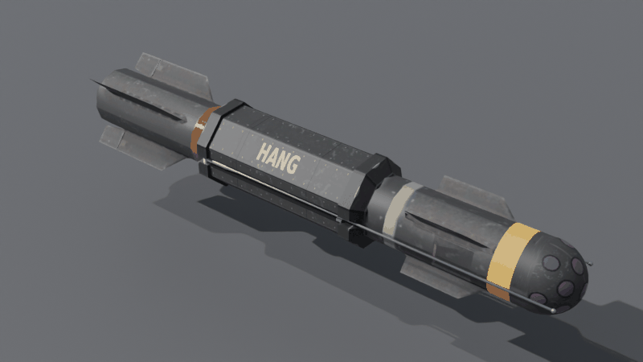

# Hangball Mk.II

**Hang-Aloft Node Guided (HANG)** variant of the Eyeball Mk.II for Nuclear Option.

When a target is selected, it flies over the target and deploys a parachute, hanging to scan and spot for Datalink as it descends. Without a target, the Hangball deploys the chute when it runs out of energy instead of self-destructing.

## Requirements

- Nuclear Option 0.34.2
- [BepInEx 5](https://github.com/BepInEx/BepInEx/releases) (Mono, x64)
- [Blueprinter](https://github.com/nikkorap/NOBlueprinter-Releases) 2.0.1 or newer

## Install

1. Install BepInEx 5 and Blueprinter.
2. Download `HangballMkII.dll` from the [latest release](../../releases/latest).
3. Put it in `Nuclear Option\BepInEx\plugins`.
4. 
## What the plugin does

`src/HangballPlugin.cs` is the full source. It only affects missiles that use an optical seeker and carry a parachute (the Hangball). Stock weapons are untouched.

- Opens the chute where the stock seeker would self-destruct.
- With a target selected, steers to 1000 m above the target and opens the chute after passing over it.
- Holds the antennas stowed until the chute is open, then unfolds them.
- Torques the missile nose-down under the chute and damps the swing.
- Detonates on touchdown.

## Credits and licence

See [CREDITS.md](CREDITS.md). The plugin source and art scripts are released under the [MIT License](LICENSE).
